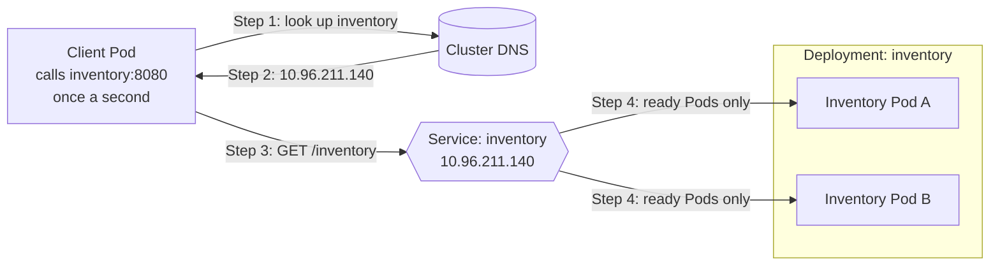

# CMPE 273 - Module 6: Service Discovery, Readiness & Recovery

For this lab I deployed a small Inventory service on Kubernetes with 2 replicas, put a Service in front of it, and ran a client that keeps calling it by name. Then I broke things on purpose: first by making one Pod unready, then by deleting a Pod. The client never changes its URL or restarts during these tests.

Everything runs on a local [kind](https://kind.sigs.k8s.io/) cluster. The service and the client are both short Python scripts that only use the standard library.

## Architecture



How a request flows:

1. The client only knows the name `inventory`, so it asks cluster DNS for it.
2. DNS answers with the Service's IP. This IP never changes, even when Pods do.
3. The client sends its request to the Service.
4. The Service passes the request to one of the Pods behind it, but only to Pods that are passing their readiness check.

Two things happen in the background:

- Kubernetes calls `/ready` on each Pod every 2 seconds. If a Pod returns an error, it is taken out of the Service until it is healthy again.
- The Deployment always keeps 2 Pods running. If one is deleted, a new one is created and the Service starts using it right away.

### Files

| File | What it does |
|---|---|
| `inventory/app.py` | The Inventory service. `/inventory` returns the stock along with the name and IP of the Pod that answered. `/ready` returns 503 if the file `/tmp/unready` exists, otherwise 200. |
| `client/client.py` | Calls `http://inventory:8080/inventory` every second and logs which Pod answered. Every 10 requests it prints a count per Pod. |
| `k8s/inventory.yaml` | Deployment with 2 replicas and a readiness probe on `/ready`, plus the `inventory` Service. |
| `k8s/client.yaml` | Deployment for the client. |
| `scripts/` | Deploy, cleanup, and one script for each test. |

One small detail: the client opens a new connection for each request. Kubernetes picks a Pod when a connection is opened, so if the client reused one connection, every request would go to the same Pod and you would never see the load being shared.

## How to run it

You need Docker, `kubectl` and `kind` (`brew install kind`). minikube or Docker Desktop also work, you just load the images differently.

```bash
./scripts/deploy.sh
```

This creates a kind cluster called `module6`, builds both images, loads them into the cluster and applies the YAML files. If you'd rather do it step by step:

```bash
kind create cluster --name module6
docker build -t inventory-service:1.0 inventory
docker build -t inventory-client:1.0 client
kind load docker-image inventory-service:1.0 inventory-client:1.0 --name module6
kubectl apply -f k8s/inventory.yaml
kubectl apply -f k8s/client.yaml
```

To watch the client live:

```bash
kubectl logs -f deployment/client
```

Each test has its own script. It prints every command it runs and saves the output in `evidence/`:

| Test | Script | Output |
|---|---|---|
| Discovery and load sharing | `./scripts/test_discovery.sh` | [evidence/1_discovery_and_load_balancing.txt](evidence/1_discovery_and_load_balancing.txt) |
| Readiness failure and recovery | `./scripts/test_readiness.sh` | [evidence/2_readiness_failure_and_recovery.txt](evidence/2_readiness_failure_and_recovery.txt) |
| Pod deletion and replacement | `./scripts/test_pod_failure.sh` | [evidence/3_pod_deletion_and_replacement.txt](evidence/3_pod_deletion_and_replacement.txt) |

You can also make a Pod unready by hand, and then bring it back:

```bash
kubectl exec <inventory-pod> -- touch /tmp/unready
```

```bash
kubectl exec <inventory-pod> -- rm /tmp/unready
```

When you're done:

```bash
./scripts/cleanup.sh
```

## 1. Deployment and service discovery

Both Inventory Pods are up, and both are listed as ready behind the `inventory` Service:

```
$ kubectl get pods -o wide
NAME                         READY   STATUS    RESTARTS   AGE   IP            NODE
client-6fb44985d9-wfmcf      1/1     Running   0          15s   10.244.0.16   module6-control-plane
inventory-6cd7699d6d-dq4dh   1/1     Running   0          18s   10.244.0.14   module6-control-plane
inventory-6cd7699d6d-fgbl8   1/1     Running   0          18s   10.244.0.15   module6-control-plane

$ kubectl get service inventory
NAME        TYPE        CLUSTER-IP      EXTERNAL-IP   PORT(S)    AGE
inventory   ClusterIP   10.96.211.140   <none>        8080/TCP   18s

$ kubectl get endpointslices -l kubernetes.io/service-name=inventory
inventory-6cd7699d6d-dq4dh  ip=10.244.0.14  ready=true
inventory-6cd7699d6d-fgbl8  ip=10.244.0.15  ready=true
```

The client is only given the Service name. Inside the client Pod, that name resolves to the Service IP, not to any Pod's IP:

```
$ kubectl get deployment client -o jsonpath={.spec.template.spec.containers[0].env[0]}
{"name":"INVENTORY_URL","value":"http://inventory:8080/inventory"}

$ kubectl exec deployment/client -- python -c "import socket; ..."
inventory -> 10.96.211.140
inventory.default.svc.cluster.local -> 10.96.211.140
```

## 2. Both replicas get requests

The client always calls the same name, but the answers come from both Pods ([full output](evidence/1_discovery_and_load_balancing.txt)):

```
$ kubectl logs deployment/client --since=20s
18:52:29.704 [client] #21 200 served by inventory-6cd7699d6d-dq4dh (10.244.0.14)
18:52:30.710 [client] #22 200 served by inventory-6cd7699d6d-dq4dh (10.244.0.14)
18:52:31.717 [client] #23 200 served by inventory-6cd7699d6d-fgbl8 (10.244.0.15)
18:52:32.720 [client] #24 200 served by inventory-6cd7699d6d-fgbl8 (10.244.0.15)
18:52:33.727 [client] #25 200 served by inventory-6cd7699d6d-dq4dh (10.244.0.14)
18:52:34.732 [client] #26 200 served by inventory-6cd7699d6d-dq4dh (10.244.0.14)
18:52:35.739 [client] #27 200 served by inventory-6cd7699d6d-dq4dh (10.244.0.14)
18:52:36.745 [client] #28 200 served by inventory-6cd7699d6d-fgbl8 (10.244.0.15)
18:52:37.747 [client] #29 200 served by inventory-6cd7699d6d-fgbl8 (10.244.0.15)
18:52:38.755 [client] #30 200 served by inventory-6cd7699d6d-dq4dh (10.244.0.14)
18:52:38.756 [client] last 10 requests: {'inventory-6cd7699d6d-dq4dh': 6, 'inventory-6cd7699d6d-fgbl8': 4}
```

The logs on each Pod show the same thing from the other side. Both Pods are serving the client at `10.244.0.16`:

```
$ kubectl logs inventory-6cd7699d6d-dq4dh --tail=2
18:52:40.764 [inventory-6cd7699d6d-dq4dh] served /inventory to 10.244.0.16
18:52:41.769 [inventory-6cd7699d6d-dq4dh] served /inventory to 10.244.0.16

$ kubectl logs inventory-6cd7699d6d-fgbl8 --tail=2
18:52:37.747 [inventory-6cd7699d6d-fgbl8] served /inventory to 10.244.0.16
18:52:42.776 [inventory-6cd7699d6d-fgbl8] served /inventory to 10.244.0.16
```

## 3. Readiness failure and recovery

To make `inventory-6cd7699d6d-dq4dh` fail its readiness check, I created `/tmp/unready` inside it. Its `/ready` endpoint now returns 503 ([full output](evidence/2_readiness_failure_and_recovery.txt)):

```
$ kubectl exec inventory-6cd7699d6d-dq4dh -- touch /tmp/unready
GET /ready -> HTTP Error 503: Service Unavailable
```

A few seconds later the Pod is still `Running` with 0 restarts, so Kubernetes did not kill it. But it shows `0/1` ready, and the Service has marked it `ready=false`:

```
$ kubectl get pods -l app=inventory -o wide
NAME                         READY   STATUS    RESTARTS   AGE   IP
inventory-6cd7699d6d-dq4dh   0/1     Running   0          45s   10.244.0.14
inventory-6cd7699d6d-fgbl8   1/1     Running   0          45s   10.244.0.15

$ kubectl get endpointslices -l kubernetes.io/service-name=inventory
inventory-6cd7699d6d-dq4dh  ip=10.244.0.14  ready=false
inventory-6cd7699d6d-fgbl8  ip=10.244.0.15  ready=true

$ kubectl get events --field-selector involvedObject.name=inventory-6cd7699d6d-dq4dh,reason=Unhealthy
LAST SEEN   TYPE      REASON      OBJECT                           MESSAGE
1s          Warning   Unhealthy   pod/inventory-6cd7699d6d-dq4dh   Readiness probe failed: HTTP probe failed with statuscode: 503
```

For the next 20 seconds, every request goes to the healthy Pod and none of them fail. The unready Pod doesn't get a single request:

```
$ kubectl logs deployment/client --since=20s
18:52:57.869 [client] #49 200 served by inventory-6cd7699d6d-fgbl8 (10.244.0.15)
18:52:58.875 [client] #50 200 served by inventory-6cd7699d6d-fgbl8 (10.244.0.15)
18:52:58.875 [client] last 10 requests: {'inventory-6cd7699d6d-fgbl8': 10}
...
18:53:07.933 [client] #59 200 served by inventory-6cd7699d6d-fgbl8 (10.244.0.15)
18:53:08.939 [client] #60 200 served by inventory-6cd7699d6d-fgbl8 (10.244.0.15)
18:53:08.939 [client] last 10 requests: {'inventory-6cd7699d6d-fgbl8': 10}

$ kubectl logs inventory-6cd7699d6d-dq4dh --since=20s | grep -c served
0
```

Then I deleted the file. The Pod passes the check again, it is still the same Pod with 0 restarts, and it starts getting traffic again:

```
$ kubectl exec inventory-6cd7699d6d-dq4dh -- rm /tmp/unready

$ kubectl get pods -l app=inventory -o wide
NAME                         READY   STATUS    RESTARTS   AGE   IP
inventory-6cd7699d6d-dq4dh   1/1     Running   0          72s   10.244.0.14
inventory-6cd7699d6d-fgbl8   1/1     Running   0          72s   10.244.0.15

$ kubectl logs deployment/client --since=20s
18:53:22.007 [client] #73 200 served by inventory-6cd7699d6d-dq4dh (10.244.0.14)
18:53:23.015 [client] #74 200 served by inventory-6cd7699d6d-dq4dh (10.244.0.14)
18:53:24.021 [client] #75 200 served by inventory-6cd7699d6d-fgbl8 (10.244.0.15)
18:53:25.026 [client] #76 200 served by inventory-6cd7699d6d-fgbl8 (10.244.0.15)
18:53:26.033 [client] #77 200 served by inventory-6cd7699d6d-dq4dh (10.244.0.14)
18:53:27.040 [client] #78 200 served by inventory-6cd7699d6d-fgbl8 (10.244.0.15)
18:53:28.048 [client] #79 200 served by inventory-6cd7699d6d-fgbl8 (10.244.0.15)
18:53:29.051 [client] #80 200 served by inventory-6cd7699d6d-dq4dh (10.244.0.14)
18:53:29.051 [client] last 10 requests: {'inventory-6cd7699d6d-fgbl8': 6, 'inventory-6cd7699d6d-dq4dh': 4}
```

## 4. Pod deletion and replacement

Next I deleted `inventory-6cd7699d6d-dq4dh`. Kubernetes created `inventory-6cd7699d6d-m58p7` straight away to replace it. The new Pod has a different name and a different IP ([full output](evidence/3_pod_deletion_and_replacement.txt)):

```
$ kubectl delete pod inventory-6cd7699d6d-dq4dh
pod "inventory-6cd7699d6d-dq4dh" deleted from default namespace

$ kubectl get pods -l app=inventory -o wide
NAME                         READY   STATUS    RESTARTS   AGE   IP
inventory-6cd7699d6d-fgbl8   1/1     Running   0          93s   10.244.0.15
inventory-6cd7699d6d-m58p7   0/1     Running   0          1s    10.244.0.17

$ kubectl get pods -l app=inventory -o wide
NAME                         READY   STATUS    RESTARTS   AGE   IP
inventory-6cd7699d6d-fgbl8   1/1     Running   0          98s   10.244.0.15
inventory-6cd7699d6d-m58p7   1/1     Running   0          6s    10.244.0.17

$ kubectl get events --field-selector involvedObject.name=inventory-6cd7699d6d,reason=SuccessfulCreate
98s         Normal   SuccessfulCreate   replicaset/inventory-6cd7699d6d   Created pod: inventory-6cd7699d6d-dq4dh
98s         Normal   SuccessfulCreate   replicaset/inventory-6cd7699d6d   Created pod: inventory-6cd7699d6d-fgbl8
6s          Normal   SuccessfulCreate   replicaset/inventory-6cd7699d6d   Created pod: inventory-6cd7699d6d-m58p7
```

What changed and what didn't:

| | Before | After |
|---|---|---|
| Pod | `inventory-6cd7699d6d-dq4dh` (10.244.0.14) | `inventory-6cd7699d6d-m58p7` (10.244.0.17) |
| Service name | `inventory` | `inventory` |
| Service IP | 10.96.211.140 | 10.96.211.140 |
| Client URL | `http://inventory:8080/inventory` | `http://inventory:8080/inventory` |

The Service itself is untouched. Its endpoint list already has the new Pod in it:

```
$ kubectl get service inventory
NAME        TYPE        CLUSTER-IP      EXTERNAL-IP   PORT(S)    AGE
inventory   ClusterIP   10.96.211.140   <none>        8080/TCP   98s

$ kubectl get endpointslices -l kubernetes.io/service-name=inventory
inventory-6cd7699d6d-fgbl8  ip=10.244.0.15  ready=true
inventory-6cd7699d6d-m58p7  ip=10.244.0.17  ready=true
```

On the client side nothing changed. It is the same Pod with 0 restarts, still calling the same name. It had no failed requests during the deletion, and it is already getting answers from the new Pod:

```
$ kubectl logs deployment/client --since=15s
18:53:46.152 [client] #97 200 served by inventory-6cd7699d6d-fgbl8 (10.244.0.15)
18:53:47.155 [client] #98 200 served by inventory-6cd7699d6d-m58p7 (10.244.0.17)
18:53:48.160 [client] #99 200 served by inventory-6cd7699d6d-m58p7 (10.244.0.17)
18:53:49.164 [client] #100 200 served by inventory-6cd7699d6d-fgbl8 (10.244.0.15)
18:53:49.164 [client] last 10 requests: {'inventory-6cd7699d6d-fgbl8': 5, 'inventory-6cd7699d6d-m58p7': 5}

$ kubectl get pods -l app=client
NAME                      READY   STATUS    RESTARTS   AGE
client-6fb44985d9-wfmcf   1/1     Running   0          110s

$ kubectl logs deployment/client --since=40s | grep -c FAILED
0
```

## Reflection

Pods don't last. When one crashes or gets deleted, Kubernetes replaces it with a new Pod that has a new name and a new IP, so a client that saved Pod addresses would break every time. A Service fixes this by giving the client one name and one IP that never change, no matter which Pods are running behind it. Kubernetes keeps the list of Pods behind the Service up to date by itself: new Pods are added, deleted Pods are removed, and Pods that fail their readiness check are skipped. In this lab the client kept getting answers while a Pod was unready and while a Pod was replaced, and I never had to touch its configuration.
