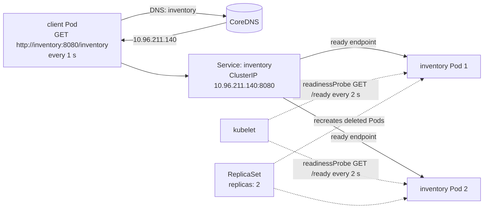

# CMPE 273 - Module 6: Service Discovery, Readiness & Recovery

An Inventory service running as 2 replicas behind a Kubernetes Service, plus a client that calls it by the Service name `inventory`. Both are small Python programs (standard library only) running on a local [kind](https://kind.sigs.k8s.io/) cluster.

## Architecture



| Component | File | What it does |
|---|---|---|
| Inventory service | `inventory/app.py` | `GET /inventory` returns stock plus the Pod name and IP that answered. `GET /ready` returns 503 while `/tmp/unready` exists, otherwise 200. `GET /healthz` is the liveness check. |
| Client | `client/client.py` | Calls `http://inventory:8080/inventory` once a second, logs which Pod answered, and prints a count per Pod every 10 requests. |
| Deployment + Service | `k8s/inventory.yaml` | 2 replicas, readiness probe (`/ready`, period 2 s, failure threshold 1), liveness probe, ClusterIP Service `inventory` selecting `app=inventory`. |
| Client Deployment | `k8s/client.yaml` | 1 replica, `INVENTORY_URL=http://inventory:8080/inventory`. |

The client opens a new connection for every request. kube-proxy picks a backend per connection, so a reused keep-alive connection would always land on the same Pod.

## Deploying

Requirements: Docker, `kubectl`, and `kind` (`brew install kind`). minikube or Docker Desktop Kubernetes also work; only the image-loading step changes.

```bash
./scripts/deploy.sh
```

This creates a kind cluster called `module6` (if needed), builds both images, loads them into the cluster, and applies the manifests. The same steps by hand:

```bash
kind create cluster --name module6
docker build -t inventory-service:1.0 inventory
docker build -t inventory-client:1.0 client
kind load docker-image inventory-service:1.0 inventory-client:1.0 --name module6
kubectl apply -f k8s/inventory.yaml
kubectl apply -f k8s/client.yaml
```

Watch the client:

```bash
kubectl logs -f deployment/client
```

## Running the tests

Each script prints the commands it runs and saves the output to `evidence/`.

| Script | Evidence |
|---|---|
| `./scripts/test_discovery.sh` | [evidence/1_discovery_and_load_balancing.txt](evidence/1_discovery_and_load_balancing.txt) |
| `./scripts/test_readiness.sh` | [evidence/2_readiness_failure_and_recovery.txt](evidence/2_readiness_failure_and_recovery.txt) |
| `./scripts/test_pod_failure.sh` | [evidence/3_pod_deletion_and_replacement.txt](evidence/3_pod_deletion_and_replacement.txt) |

Readiness can also be toggled by hand:

```bash
kubectl exec <inventory-pod> -- touch /tmp/unready
```

```bash
kubectl exec <inventory-pod> -- rm /tmp/unready
```

Cleanup:

```bash
./scripts/cleanup.sh
```

## 1. Deployment and service discovery

Both replicas are running and both are ready endpoints of the `inventory` Service:

```
$ kubectl get pods -o wide
NAME                         READY   STATUS    RESTARTS   AGE   IP            NODE
client-6fb44985d9-wfmcf      1/1     Running   0          15s   10.244.0.16   module6-control-plane
inventory-6cd7699d6d-dq4dh   1/1     Running   0          18s   10.244.0.14   module6-control-plane
inventory-6cd7699d6d-fgbl8   1/1     Running   0          18s   10.244.0.15   module6-control-plane

$ kubectl get service inventory
NAME        TYPE        CLUSTER-IP      EXTERNAL-IP   PORT(S)    AGE
inventory   ClusterIP   10.96.211.140   <none>        8080/TCP   18s

$ kubectl get endpointslices -l kubernetes.io/service-name=inventory
inventory-6cd7699d6d-dq4dh  ip=10.244.0.14  ready=true
inventory-6cd7699d6d-fgbl8  ip=10.244.0.15  ready=true
```

The client is configured with the Service name only, and cluster DNS resolves that name to the Service's ClusterIP, not to a Pod IP:

```
$ kubectl get deployment client -o jsonpath={.spec.template.spec.containers[0].env[0]}
{"name":"INVENTORY_URL","value":"http://inventory:8080/inventory"}

$ kubectl exec deployment/client -- python -c "import socket; ..."
inventory -> 10.96.211.140
inventory.default.svc.cluster.local -> 10.96.211.140
```

## 2. Both replicas receive requests

Requests to the same Service name are answered by both Pods ([full output](evidence/1_discovery_and_load_balancing.txt)):

```
$ kubectl logs deployment/client --since=20s
18:52:29.704 [client] #21 200 served by inventory-6cd7699d6d-dq4dh (10.244.0.14)
18:52:30.710 [client] #22 200 served by inventory-6cd7699d6d-dq4dh (10.244.0.14)
18:52:31.717 [client] #23 200 served by inventory-6cd7699d6d-fgbl8 (10.244.0.15)
18:52:32.720 [client] #24 200 served by inventory-6cd7699d6d-fgbl8 (10.244.0.15)
18:52:33.727 [client] #25 200 served by inventory-6cd7699d6d-dq4dh (10.244.0.14)
18:52:34.732 [client] #26 200 served by inventory-6cd7699d6d-dq4dh (10.244.0.14)
18:52:35.739 [client] #27 200 served by inventory-6cd7699d6d-dq4dh (10.244.0.14)
18:52:36.745 [client] #28 200 served by inventory-6cd7699d6d-fgbl8 (10.244.0.15)
18:52:37.747 [client] #29 200 served by inventory-6cd7699d6d-fgbl8 (10.244.0.15)
18:52:38.755 [client] #30 200 served by inventory-6cd7699d6d-dq4dh (10.244.0.14)
18:52:38.756 [client] last 10 requests: {'inventory-6cd7699d6d-dq4dh': 6, 'inventory-6cd7699d6d-fgbl8': 4}
```

Each replica's own log confirms it served the client (`10.244.0.16`):

```
$ kubectl logs inventory-6cd7699d6d-dq4dh --tail=2
18:52:40.764 [inventory-6cd7699d6d-dq4dh] served /inventory to 10.244.0.16
18:52:41.769 [inventory-6cd7699d6d-dq4dh] served /inventory to 10.244.0.16

$ kubectl logs inventory-6cd7699d6d-fgbl8 --tail=2
18:52:37.747 [inventory-6cd7699d6d-fgbl8] served /inventory to 10.244.0.16
18:52:42.776 [inventory-6cd7699d6d-fgbl8] served /inventory to 10.244.0.16
```

## 3. Readiness failure and recovery

`inventory-6cd7699d6d-dq4dh` is made unready by creating `/tmp/unready`, which makes its `/ready` endpoint return 503 ([full output](evidence/2_readiness_failure_and_recovery.txt)):

```
$ kubectl exec inventory-6cd7699d6d-dq4dh -- touch /tmp/unready
GET /ready -> HTTP Error 503: Service Unavailable
```

The Pod is still `Running` with 0 restarts, but it is `0/1` ready and the Service marks its endpoint `ready=false`:

```
$ kubectl get pods -l app=inventory -o wide
NAME                         READY   STATUS    RESTARTS   AGE   IP
inventory-6cd7699d6d-dq4dh   0/1     Running   0          45s   10.244.0.14
inventory-6cd7699d6d-fgbl8   1/1     Running   0          45s   10.244.0.15

$ kubectl get endpointslices -l kubernetes.io/service-name=inventory
inventory-6cd7699d6d-dq4dh  ip=10.244.0.14  ready=false
inventory-6cd7699d6d-fgbl8  ip=10.244.0.15  ready=true

$ kubectl get events --field-selector involvedObject.name=inventory-6cd7699d6d-dq4dh,reason=Unhealthy
LAST SEEN   TYPE      REASON      OBJECT                           MESSAGE
1s          Warning   Unhealthy   pod/inventory-6cd7699d6d-dq4dh   Readiness probe failed: HTTP probe failed with statuscode: 503
```

For the next 20 seconds every request is served by the ready Pod, with no errors, and the unready Pod serves nothing:

```
$ kubectl logs deployment/client --since=20s
18:52:57.869 [client] #49 200 served by inventory-6cd7699d6d-fgbl8 (10.244.0.15)
18:52:58.875 [client] #50 200 served by inventory-6cd7699d6d-fgbl8 (10.244.0.15)
18:52:58.875 [client] last 10 requests: {'inventory-6cd7699d6d-fgbl8': 10}
...
18:53:07.933 [client] #59 200 served by inventory-6cd7699d6d-fgbl8 (10.244.0.15)
18:53:08.939 [client] #60 200 served by inventory-6cd7699d6d-fgbl8 (10.244.0.15)
18:53:08.939 [client] last 10 requests: {'inventory-6cd7699d6d-fgbl8': 10}

$ kubectl logs inventory-6cd7699d6d-dq4dh --since=20s | grep -c served
0
```

Readiness is restored by removing the file. The Pod is ready again (still 0 restarts) and receives traffic again:

```
$ kubectl exec inventory-6cd7699d6d-dq4dh -- rm /tmp/unready

$ kubectl get pods -l app=inventory -o wide
NAME                         READY   STATUS    RESTARTS   AGE   IP
inventory-6cd7699d6d-dq4dh   1/1     Running   0          72s   10.244.0.14
inventory-6cd7699d6d-fgbl8   1/1     Running   0          72s   10.244.0.15

$ kubectl logs deployment/client --since=20s
18:53:22.007 [client] #73 200 served by inventory-6cd7699d6d-dq4dh (10.244.0.14)
18:53:23.015 [client] #74 200 served by inventory-6cd7699d6d-dq4dh (10.244.0.14)
18:53:24.021 [client] #75 200 served by inventory-6cd7699d6d-fgbl8 (10.244.0.15)
18:53:25.026 [client] #76 200 served by inventory-6cd7699d6d-fgbl8 (10.244.0.15)
18:53:26.033 [client] #77 200 served by inventory-6cd7699d6d-dq4dh (10.244.0.14)
18:53:27.040 [client] #78 200 served by inventory-6cd7699d6d-fgbl8 (10.244.0.15)
18:53:28.048 [client] #79 200 served by inventory-6cd7699d6d-fgbl8 (10.244.0.15)
18:53:29.051 [client] #80 200 served by inventory-6cd7699d6d-dq4dh (10.244.0.14)
18:53:29.051 [client] last 10 requests: {'inventory-6cd7699d6d-fgbl8': 6, 'inventory-6cd7699d6d-dq4dh': 4}
```

## 4. Pod deletion and replacement

`inventory-6cd7699d6d-dq4dh` is deleted. The ReplicaSet immediately creates `inventory-6cd7699d6d-m58p7`, which has a new name and a new IP ([full output](evidence/3_pod_deletion_and_replacement.txt)):

```
$ kubectl delete pod inventory-6cd7699d6d-dq4dh
pod "inventory-6cd7699d6d-dq4dh" deleted from default namespace

$ kubectl get pods -l app=inventory -o wide
NAME                         READY   STATUS    RESTARTS   AGE   IP
inventory-6cd7699d6d-fgbl8   1/1     Running   0          93s   10.244.0.15
inventory-6cd7699d6d-m58p7   0/1     Running   0          1s    10.244.0.17

$ kubectl get pods -l app=inventory -o wide
NAME                         READY   STATUS    RESTARTS   AGE   IP
inventory-6cd7699d6d-fgbl8   1/1     Running   0          98s   10.244.0.15
inventory-6cd7699d6d-m58p7   1/1     Running   0          6s    10.244.0.17

$ kubectl get events --field-selector involvedObject.name=inventory-6cd7699d6d,reason=SuccessfulCreate
98s         Normal   SuccessfulCreate   replicaset/inventory-6cd7699d6d   Created pod: inventory-6cd7699d6d-dq4dh
98s         Normal   SuccessfulCreate   replicaset/inventory-6cd7699d6d   Created pod: inventory-6cd7699d6d-fgbl8
6s          Normal   SuccessfulCreate   replicaset/inventory-6cd7699d6d   Created pod: inventory-6cd7699d6d-m58p7
```

| | Before | After |
|---|---|---|
| Deleted / new Pod | `inventory-6cd7699d6d-dq4dh` (10.244.0.14) | `inventory-6cd7699d6d-m58p7` (10.244.0.17) |
| Service name | `inventory` | `inventory` |
| ClusterIP | 10.96.211.140 | 10.96.211.140 |
| Client URL | `http://inventory:8080/inventory` | `http://inventory:8080/inventory` |

The Service is unchanged and its endpoints now list the new Pod:

```
$ kubectl get service inventory
NAME        TYPE        CLUSTER-IP      EXTERNAL-IP   PORT(S)    AGE
inventory   ClusterIP   10.96.211.140   <none>        8080/TCP   98s

$ kubectl get endpointslices -l kubernetes.io/service-name=inventory
inventory-6cd7699d6d-fgbl8  ip=10.244.0.15  ready=true
inventory-6cd7699d6d-m58p7  ip=10.244.0.17  ready=true
```

The client was not restarted or reconfigured. It kept calling the same Service name, had no failed requests across the deletion, and now reaches the new Pod:

```
$ kubectl logs deployment/client --since=15s
18:53:46.152 [client] #97 200 served by inventory-6cd7699d6d-fgbl8 (10.244.0.15)
18:53:47.155 [client] #98 200 served by inventory-6cd7699d6d-m58p7 (10.244.0.17)
18:53:48.160 [client] #99 200 served by inventory-6cd7699d6d-m58p7 (10.244.0.17)
18:53:49.164 [client] #100 200 served by inventory-6cd7699d6d-fgbl8 (10.244.0.15)
18:53:49.164 [client] last 10 requests: {'inventory-6cd7699d6d-fgbl8': 5, 'inventory-6cd7699d6d-m58p7': 5}

$ kubectl get pods -l app=client
NAME                      READY   STATUS    RESTARTS   AGE
client-6fb44985d9-wfmcf   1/1     Running   0          110s

$ kubectl logs deployment/client --since=40s | grep -c FAILED
0
```

## Reflection

Pods are temporary: when one fails or is deleted, Kubernetes replaces it with a new Pod that has a different name and IP, so a client that stored Pod addresses would break every time this happens. A Service gives the client one stable name (`inventory`) and one stable ClusterIP that stay the same no matter which Pods are behind it. Kubernetes keeps the Service's endpoint list up to date on its own, adding new Pods, removing deleted ones, and skipping Pods that fail their readiness probe. In this lab the client never changed its URL or restarted, yet it kept getting answers while a Pod was unready and while a Pod was deleted and replaced. This separates "who to call" from "where it is running", which is what lets replicas fail, recover and scale without the client noticing.
